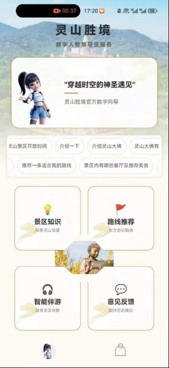
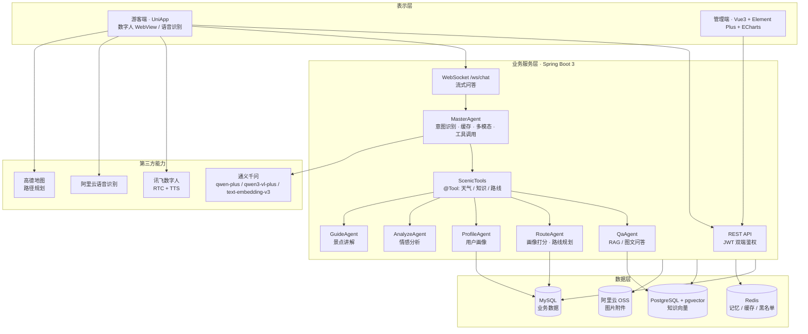
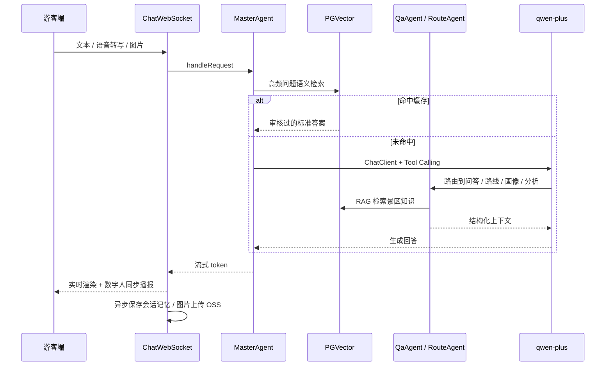
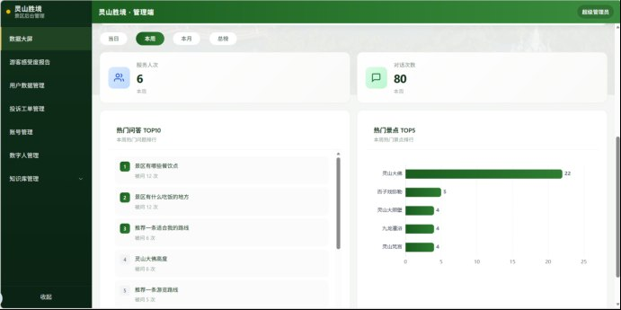
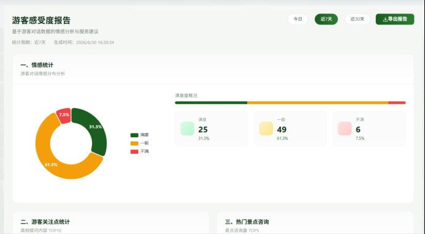
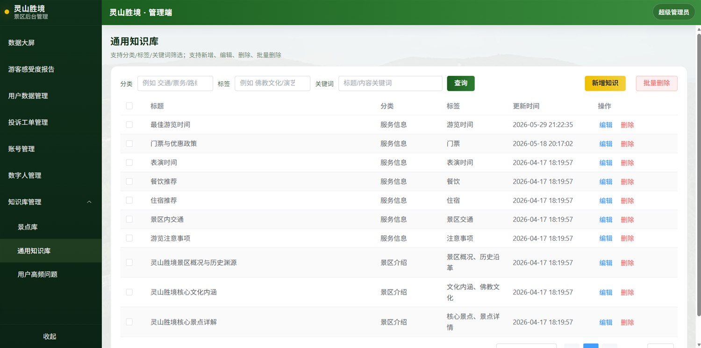
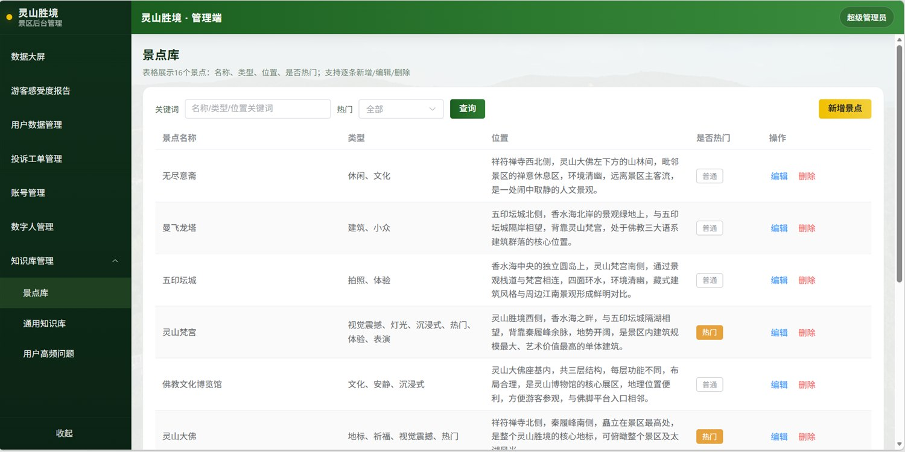
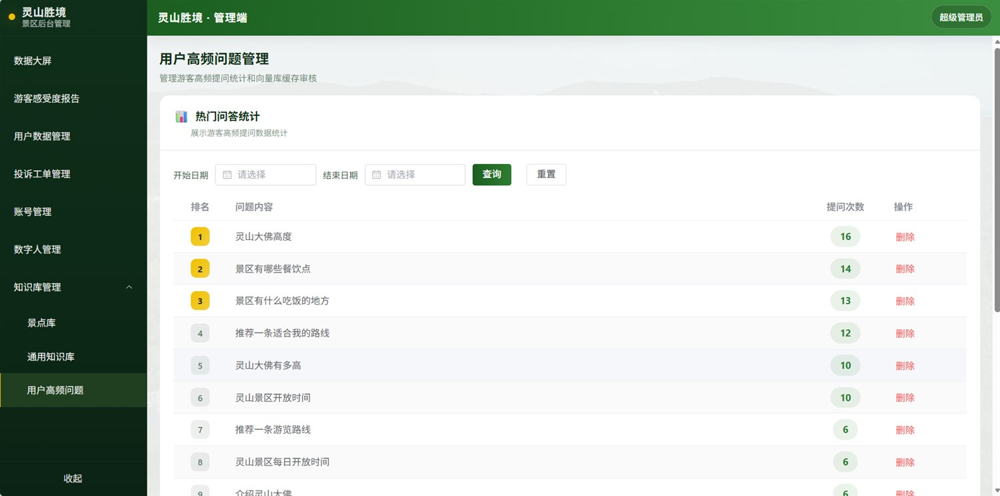
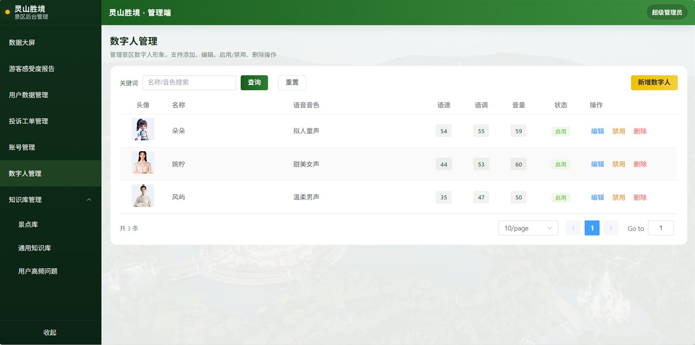

# ScenicMind

**灵山胜境 · AI 数字人智慧导览系统**

基于 **Spring AI + Master-Agent 多智能体** 的景区 AI 服务平台：游客端（UniApp）+ 管理端（Vue 3）+ 后端（Spring Boot 3），覆盖智能问答、数字人讲解、手绘地图导览、个性化路线、AI 游记与景区运营后台。

[](https://openjdk.org/)
[](https://spring.io/projects/spring-boot)
[](https://spring.io/projects/spring-ai)
[](https://vuejs.org/)
[](https://uniapp.dcloud.net.cn/)
[](https://docs.docker.com/compose/)

> 2025 中国软件杯 · A5 赛道「景区导览服务 AI 数字人」参赛作品 · 队伍：双人成行


---

## 演示

- 📼 **演示视频（B站）**：[【第十五届软件杯 A5 赛道】数字人导游项目视频-哔哩哔哩](https://b23.tv/ppvdZ5R)
- 📑 **产品设计文档 / 答辩PPT / 使用手册**：[SpringAI数字人资料](https://pan.baidu.com/s/13rT9oHwB6mZBmtkXn5V1xg)（提取码: 6666）
- 🧪 **演示账号**：管理端 `admin / admin123`



---

## 这个项目解决什么问题

传统景区导览依赖人工导游、固定录音设备和纸质地图：讲解成本高、内容不标准、无法问答、没有数据沉淀；山体与古建遮挡还会导致 GPS 漂移，手绘地图难以精准导航。

ScenicMind 用「大模型 + 多智能体 + 数字人」给出可落地的一体化方案：

- **游客侧**：语音/文字/拍照都能问，数字人实时讲解，手绘地图定位与到点触发，按画像推荐路线，行程结束一键生成游记。
- **景区侧**：知识库统一维护并同步向量库，数字人形象可配置，投诉工单闭环处理，运营大屏与 AI 分析报告辅助决策。

---

## 系统架构



### 一次问答的完整链路



---

## 核心亮点

| 亮点 | 实现 |
|---|---|
| **Master-Agent 多智能体调度** | `MasterAgent` 统一入口，用 Spring AI `@Tool` 注册 `getWeather` / `queryKnowledge` / `planRoute`，按意图把任务分发给 5 个子 Agent；实例绑定解耦异步上下文，避免流式线程丢失工具调用 |
| **混合 RAG** | MySQL 存业务知识 + pgvector 存语义向量（`text-embedding-v3`，1024 维）；知识新增/修改/删除时双写向量库；高频问答走语义缓存，命中直接返回审核过的标准答案 |
| **低延迟实时交互** | WebSocket 长连接 + LLM 流式输出 + 数字人音频同步；`ChatWebSocket` 按 `msgId` 绑定请求，支持断线重连与超时保护 |
| **多模态问答** | 文本走 `ChatClient`，图片走通义 `qwen3-vl-plus` 多模态接口；未开定位时可用「拍照识景」兜底 |
| **手绘地图精准导览** | 仿射变换 / 逆变换建立经纬度与手绘地图 XY 的映射，结合 PDR 航迹推算与到点检测，触发对应景点讲解 |
| **四库混合存储** | MySQL（业务）+ Redis（验证码 / 会话记忆 / 热缓存 / Token 黑名单）+ pgvector（向量）+ OSS（图片） |
| **双端独立鉴权** | 游客与管理员两套 JWT 密钥，Redis 维护 Token 状态，WebSocket 握手同样校验 |

---

## 技术栈

| 层次 | 选型 |
|---|---|
| 后端框架 | Spring Boot 3.3.5、Spring AI 1.1.3、MyBatis-Plus 3.5.9 |
| 大模型 | 通义千问 `qwen-plus`（对话）、`qwen3-vl-plus`（多模态）、`text-embedding-v3`（向量） |
| 数据存储 | MySQL 8、Redis 7、PostgreSQL 16 + pgvector、阿里云 OSS |
| 实时通信 | WebSocket（`/ws/chat`）、Spring AI `ChatClient` 流式输出 |
| 数字人 | 讯飞数字人 RTC + TTS，UniApp 原生插件 / WebView + RTCPlayer |
| 语音 | 阿里云智能语音交互（WebSocket 实时识别） |
| 游客端 | UniApp（Vue 3）、HBuilderX、高德地图 |
| 管理端 | Vue 3.5、Vite、Element Plus、Pinia、ECharts |
| 部署 | Docker Compose（MySQL / PostgreSQL / Redis / 后端 / Nginx） |

---

## 功能清单

### 游客端（`uniapp-app`，16 个页面）

| 模块 | 能力 |
|---|---|
| 启动与登录 | 景区轮播启动页、手机号验证码登录、Token 自动续期 |
| 首页 | 数字人欢迎播报、热门问题滚动、四大功能入口 |
| AI 智能问答 | 文本 / 语音 / 图片输入，流式回答，历史会话 |
| 数字人 | 形象切换、自动播报、流式播报、整段讲解 |
| 智能导览 | 手绘地图、实时定位、路线绘制、到点提醒、景点讲解 |
| 路线推荐 | 基于画像与热度的个性化路线、收藏与复用 |
| 游记 | 行程汇总、AI 生成游记、游记详情 |
| 个人中心 | 资料修改、头像形象、收藏路线、反馈记录、意见反馈 |

### 管理端（`admin-web`，10 个页面）

| 模块 | 能力 |
|---|---|
| 数据大屏 | 访问量、对话量、满意度、热门景点 / 问答 TOP 榜 |
| 游客感受度报告 | 满意度分布、投诉类型、高频咨询、趋势图 |
| 用户管理 | 手机号检索、用户档案、历史对话与情绪 |
| 投诉工单 | 多维筛选、状态流转、闭环处理 |
| 景点库 | 景点档案增删改查、批量操作 |
| 知识库 | 知识文档维护，保存即同步向量库 |
| 高频问题 | 热问统计、向量库审核、删除 |
| 数字人管理 | 形象新增、音色 / 语速 / 音量配置、启停 |
| 账号管理 | 管理员增删改、启停、密码修改 |

---

## 界面预览

### 游客端 · UniApp

| 首页 / 数字人入口 | AI 问答 / 路线推荐 |
| ---- | ---- |
| < img src="docs/images/app-home.jpg" width="360"/> | < img src="docs/images/app-ai-chat.jpg" width="360"/> |

| 数字人讲解 | 手绘地图导览 |
| ---- | ---- |
| < img src="docs/images/app-digital-human.jpg" width="360"/> | < img src="docs/images/app-guide-map.jpg" width="360"/> |

| 到点触发讲解 | 手机验证码登录 |
| ---- | ---- |
| < img src="docs/images/app-guide-arrival.jpg" width="360"/> | < img src="docs/images/app-login.jpg" width="360"/> |


### 管理端 · Vue3 + Element Plus



运营数据大屏：访问量、对话量、满意度、热门景点 / 问答 TOP 榜。



游客感受度报告：满意度分布、投诉类型、高频咨询、趋势图。



知识库：知识文档维护，保存即同步向量库。



景点库：景点档案增删改查、批量操作。



高频问题：热问统计、向量库审核、删除。



数字人管理：形象新增、音色 / 语速 / 音量配置、启停。

---

## 目录结构

```
ScenicMind/
├── backend/                 # Spring Boot 3 + Spring AI 后端
│   ├── src/main/java/com/cmyhyq/
│   │   ├── ai/              # MasterAgent / 子 Agent / Prompt / RAG / Tools
│   │   ├── controller/      # admin 端 + user 端接口
│   │   ├── service/         # 业务服务
│   │   ├── pojo/            # entity / dto / vo
│   │   ├── config/          # AI、鉴权、WebSocket、Redis 配置
│   │   └── websocket/       # ChatWebSocket 流式对话
│   └── src/main/resources/  # application.yml / MyBatis XML
├── admin-web/               # Vue3 管理后台
├── uniapp-app/              # UniApp 游客端
├── deploy/
│   ├── docker-compose.yml   # 一键部署（源码构建）
│   ├── .env.example         # 环境变量模板
│   ├── nginx/admin.conf     # 静态资源 + API / WS 反向代理
│   └── sql/
│       ├── mysql/           # 表结构 + 脱敏示例数据
│       └── pgvector/        # 向量扩展初始化
└── docs/images/             # README 截图
```

---

## 快速开始

### 方式一：Docker 一键启动（推荐）

前置：安装 Docker Desktop，并准备一个可用的 DashScope API Key。

```bash
cd deploy
cp .env.example .env
# 编辑 .env：至少填写 MYSQL_ROOT_PASSWORD、POSTGRES_PASSWORD、DASHSCOPE_API_KEY
docker compose up -d --build
```

启动后：

| 服务 | 地址 |
|---|---|
| 管理端 | http://localhost |
| 后端 API | http://localhost:8080 |
| MySQL | localhost:3307 |
| PostgreSQL | localhost:5432 |
| Redis | localhost:6379 |

> 数据库初始化脚本只在**首次创建数据卷**时执行。需要重置请执行 `docker compose down -v`。

### 方式二：本地开发

**后端**

1. 准备 MySQL 8、Redis 7、PostgreSQL 16（需安装 `pgvector` 扩展）。
2. 依次导入 `deploy/sql/mysql/01-schema.sql`、`02-demo-data.sql`，以及 `deploy/sql/pgvector/01-init.sql`。
3. 配置 `backend/src/main/resources/application.yml` 中的 `guide.*`，或直接设置环境变量。
4. 启动：

```bash
cd backend
./mvnw spring-boot:run
```

> 向量表由 Spring AI 首次启动时自动创建。示例知识默认只在 MySQL 中，可在管理端对知识条目执行一次“编辑保存”完成双写，或运行 `KnowledgeMigrationTest` 批量迁移。

**管理端**

```bash
cd admin-web
npm install
npm run dev        # 默认代理 /api -> http://localhost:8080
```

**游客端**

1. 用 HBuilderX 导入 `uniapp-app`。
2. 修改 `uniapp-app/config.js`：`BASE_URL` 改为后端地址（真机调试填电脑局域网 IP），`AMAP_WEB_KEY` 填高德「Web 服务」Key。
3. 在 `uniapp-app/config/xfyun.js` 填写讯飞 AppId / AppKey / ApiSecret。
4. 把讯飞数字人 Android SDK 的 `AIKit_Android_SDK_*.aar`、`avatar-core-*.aar` 放入 `uniapp-app/nativeplugins/xf-avatar/android/libs/`（仓库不包含第三方 SDK，详见该目录下 `README.md`）。
5. 在 `uniapp-app/manifest.json` 填写高德地图 Key（Android / iOS 平台 Key，用于地图 SDK）。
6. HBuilderX 云打包或自定义基座运行。

---

## 配置项

后端全部敏感配置都通过环境变量注入（见 `deploy/.env.example`）：

| 变量 | 说明 | 必填 |
|---|---|---|
| `DASHSCOPE_API_KEY` | 阿里云百炼 / DashScope Key | ✅ |
| `MYSQL_ROOT_PASSWORD` / `POSTGRES_PASSWORD` | 数据库密码 | ✅ |
| `AUTH_TOKEN_SECRET` / `ADMIN_TOKEN_SECRET` | 双端 JWT 密钥（≥32 位） | 建议 |
| `ALIOSS_*` | OSS 上传（endpoint / AK / SK / bucket） | 可选 |
| `ALIYUN_*` | 阿里云语音识别 | 可选 |
| `XFYUN_AVATAR_*` | 讯飞数字人 AppId / Key / Secret / SceneId | 可选 |
| `WEATHER_API_KEY` | 天气接口 | 可选 |
| `WECHAT_APPID` / `WECHAT_SECRET` | 微信登录 | 可选 |

游客端需要单独配置：`config.js`（后端地址）、`config/xfyun.js`（数字人）、`manifest.json`（高德 Key）。

---

## 已知限制

- 项目没有公网服务器，**APK 必须与后端处于同一局域网**才能演示，因此仓库不提供在线 Demo，建议直接看演示视频。
- 讯飞数字人 Android SDK 涉及第三方授权，未随仓库分发；缺失 `.aar` 时游客端可正常编译但数字人不可用。
- 手绘地图定位目前基于手机传感器与坐标仿射变换，尚未接入真实北斗/GPS 硬件与景区电子围栏。
- 多轮工具调用场景下响应时延仍偏高，弱网环境需要进一步做轻量化与离线兜底。

---

## Roadmap

- [ ] 推理链路优化：多级缓存 + 并行工具调用，降低首 Token 延迟
- [ ] 接入商用地图 / 高精度定位与景区电子围栏
- [ ] 弱网与离线模式：本地知识缓存 + 降级问答
- [ ] 管理端增加知识批量导入与向量重建任务
- [ ] 补充接口文档（OpenAPI）与端到端测试

---

## 团队

| 成员 | 分工 |
|---|---|
| hyqylr | 前端开发与架构设计：AI 架构设计、UniApp 跨端应用、交互与视觉 |
| cmyorangeCoding | 后端开发与架构设计：Master-Agent 架构、管理后台、数据库与权限体系 |

详见 [CONTRIBUTORS.md](CONTRIBUTORS.md)。

---

## 版权与致谢

- 本项目为参赛作品，**未声明开源许可证**；代码仅供学习与交流，未经作者许可请勿直接商用或二次分发。
- 景区图文、地图与知识内容版权归原景区及资料提供方所有，仅用于赛事演示。
- 第三方能力：Spring AI、阿里云通义千问 / 语音 / OSS、讯飞数字人、高德地图、RTCPlayer SDK，相关版权归各自厂商所有。
- 感谢指导老师李志民在项目设计与答辩过程中的指导。
